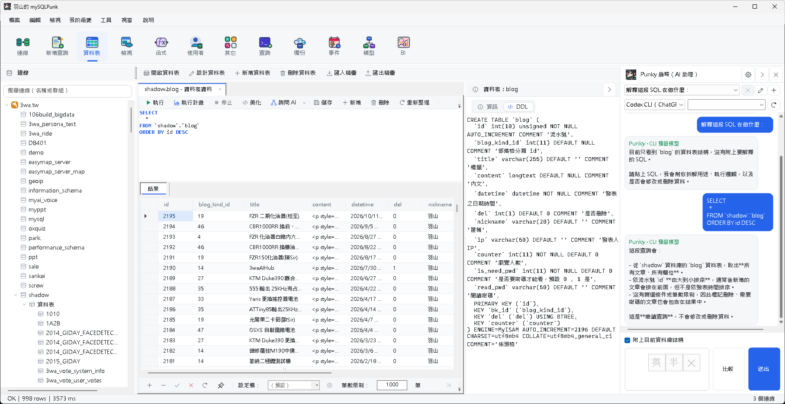
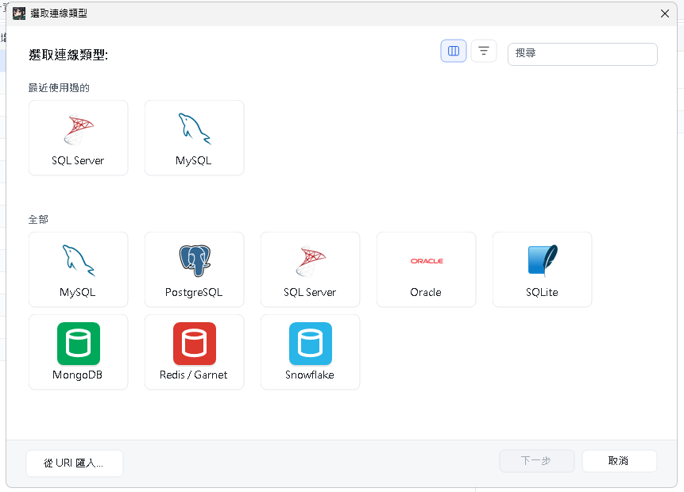
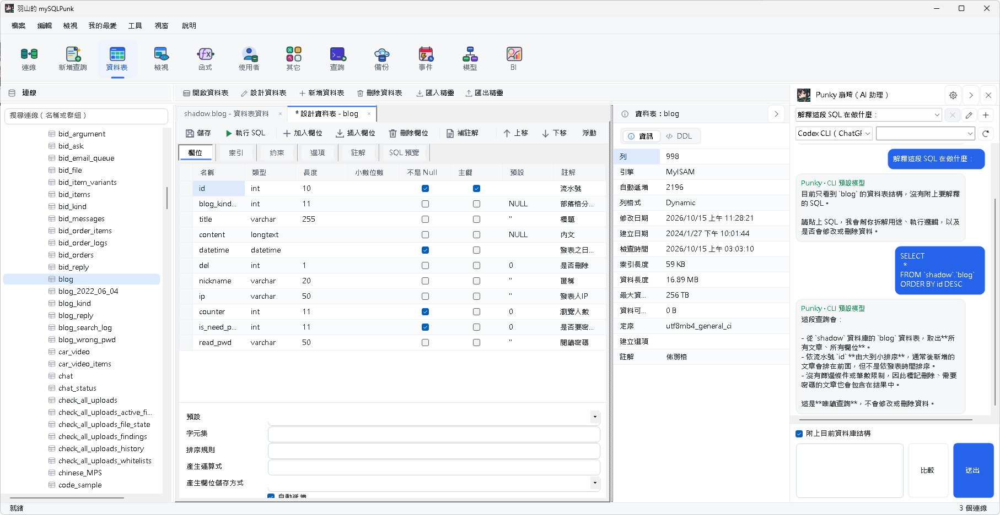
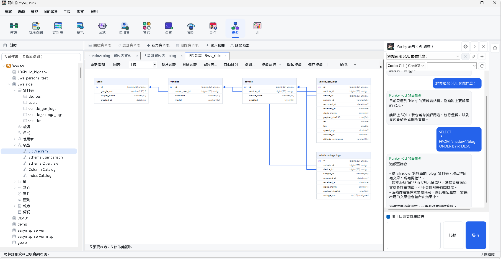
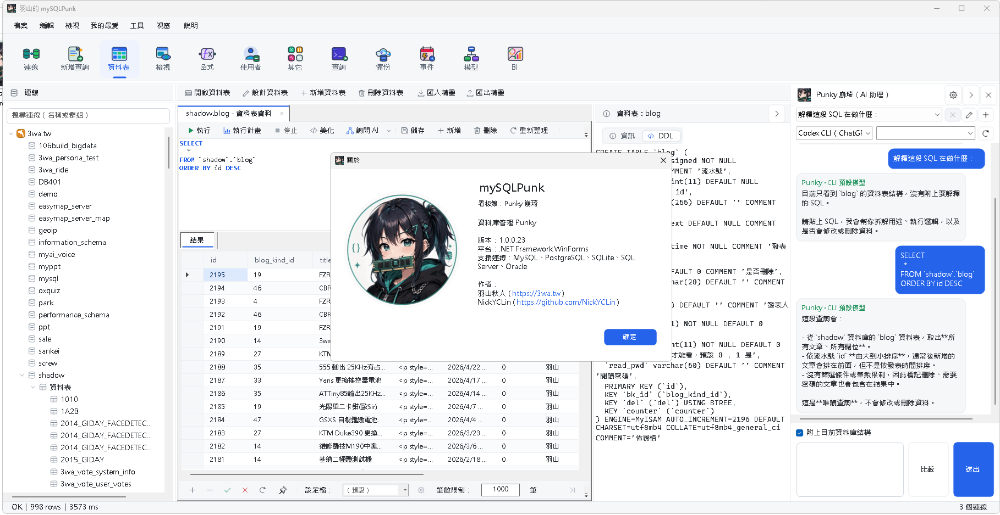

# mySQLPunk

<p align="center">
  
</p>

<p align="center">
  <strong>「陪你一起搞定所有資料庫！不管是寫 SQL、改 Table 還是查架構，通通交給我和 mySQLPunk 吧！」</strong><br>
  —— 看板娘 <strong>Punky 崩琦</strong> ⚡
</p>

<p align="center">
  <a href="https://github.com/shadowjohn/mySQLPunk/actions/workflows/auto-release.yml"></a>
  <a href="https://github.com/shadowjohn/mySQLPunk/releases/latest"></a>
  <a href="LICENSE"></a>
  
  
</p>

<p align="center">
  <strong>mySQLPunk</strong> 是一套<strong>免費開源、跨平台、現代化</strong>的多資料庫管理工作台與 SQL 編輯器。<br>
  提供 <strong>Windows 完整版 (WinForms)</strong> 以及 <strong>Linux / macOS 跨平台預覽版 (Avalonia)</strong>。<br>
  無論是關聯式資料庫、NoSQL 還是雲端資料倉儲，mySQLPunk 都能讓你用同一個順手、直覺的介面輕鬆駕馭！
</p>

<p align="center">
  <a href="https://github.com/shadowjohn/mySQLPunk/releases/latest">📦 立即下載最新版</a> · 
  <a href="#-精彩功能截圖">📸 功能截圖</a> · 
  <a href="#-核心亮點">✨ 核心亮點</a> · 
  <a href="#-看板娘-punky-崩琦">💖 認識 Punky</a> · 
  <a href="TODO.md">📝 待辦規劃 (TODO)</a> · 
  <a href="docs/DEVELOPMENT.md">🛠️ 開發指南</a>
</p>

---

## 🌟 為什麼選擇 mySQLPunk？

- 🐬 **一個介面搞定 8+ 種主流資料庫**：支援 MySQL、MariaDB、PostgreSQL、SQL Server、SQLite / SpatiaLite、Oracle、MongoDB、Redis / Microsoft Garnet 與 Snowflake！
- 🤖 **內建 Punky AI 雙引擎助理**：支援 OpenAI 相容 API、Ollama、LM Studio，以及 Codex CLI、Claude Code CLI 與 Antigravity CLI。可並排比較兩個模型的 SQL 解釋與最佳化建議！
- 🎨 **視覺化資料庫工具**：視覺化 Table Designer、ER Diagram 實體關聯圖、資料庫結構差異比較與資料字典產出。
- 🛡️ **資料安全第一、拒絕誤失**：密碼交給 Windows 認證管理員 / Linux Secret Service / macOS Keychain 保存，設定檔絕無明文密碼；寫入具備樂觀鎖與嚴密型別防護。
- ⚡ **定時排程與自動化**：內建自動化作業，支援查詢匯出、SQL 備份與 Windows Task Scheduler 排程。
- 💖 **元氣滿滿的龐克看板娘**：Punky 崩琦常駐陪你寫 code，會在關於視窗眨眼打招呼，匯出報表時還會賣力幫忙整理！

---

## 📸 精彩功能截圖

### 1. 現代俐落的主工作台與 Punky AI 助理
> 整合物件導航樹、多頁籤 SQL 編輯器、資料表即時瀏覽，以及隨時解讀 SQL、最佳化查詢的 **Punky AI 助理**！



---

### 2. 多資料庫快速連線管理
> 卡片式直覺介面，支援主流關聯式與 NoSQL 資料庫，更提供標準連線 URI 一鍵匯入與 SSH Tunnel 穿透內網。



---

### 3. 直覺的資料表設計器 (Table Designer)
> 視覺化編輯欄位、資料型別、索引、約束與註解，右側即時展示引擎統計與自動產生安全 DDL！



---

### 4. 視覺化 ER Diagram 實體關聯圖
> 一鍵產出清晰的關聯模型圖，外鍵連線、主鍵標示一目了然，支援縮放與結構匯出。



---

### 5. 資料庫匯出精靈與即時進度
> Punky 抱著筆電努力整理資料中！具備分批傳輸、一致性快照、傳輸速度估算與安全取消機制。


---

### 6. 關於視窗：會眨眼的 Punky 崩琦！
> 在「說明 > 關於」視窗中，Punky 咬著經典的綠色記憶體條，俏皮眨眼向你打招呼！



---

## 💖 看板娘：Punky 崩琦

<p align="center">
  
</p>

- **身分**：mySQLPunk 專屬資料庫助手
- **特徵**：深墨黑高馬尾、青綠色挑染、水靈的大眼睛、俐落的黑色拉鍊連帽外套、銀色鏈飾，手邊總帶著一根標誌性的綠色 RAM 記憶體條！
- **性格**：親切、專注、帶點小小俏皮的程式設計師氣質。
- **角色設定與圖像規範**：詳細介紹與 Prompt 設定請參見 [`avatar_prompt.md`](avatar_prompt.md)。

---

## ⚡ 核心功能一覽

| 功能模組 | 功能說明 |
| :--- | :--- |
| **多資料庫連線** | 支援 MySQL / MariaDB、PostgreSQL、SQL Server、SQLite、Oracle、MongoDB、Redis、Snowflake。支援 SSL/TLS、SSH Tunnel 內網穿透與 URI 匯入。 |
| **SQL 編輯與查詢** | 智慧自動完成、語法高亮、執行計畫 (Explain Plan)、查詢歷程記錄、多格式匯出 (CSV / TSV / JSON / Excel)。 |
| **資料表資料維護** | 具備 Primary Key 穩定分頁、雙向資料編輯、安全樂觀並行比對 (Optimistic Concurrency)，防止並行編輯覆蓋。 |
| **Punky AI 助理** | 右側常駐面板，支援單擊帶入 SQL 進行語法解讀、錯誤診斷、效能改進與跨方言轉換；支援雙模型並排結果對照。 |
| **Table Designer** | 視覺化欄位設計器，支援欄位屬性、索引、約束 (Check/FK) 與 DDL 預覽。 |
| **資料模型與分析** | 一鍵產生 ER Diagram 關聯圖、資料庫結構差異比較 (Schema Diff)、資料字典 HTML 匯出，以及欄位資料分佈分析。 |
| **自動化排程作業** | 定期查詢、資料匯出與 SQL 備份作業，整合 Windows Task Scheduler 實現無人值守自動備份。 |
| **連線密碼防護** | 密碼儲存於系統級憑證管理庫 (Windows Credential Manager / macOS Keychain / Linux Secret Service)，設定檔絕不留明文密碼。 |

> 深入瞭解型別安全與並行控制技術細節，請參閱 [`docs/DATA_SAFETY_SPEC.md`](docs/DATA_SAFETY_SPEC.md)。

---

## 💻 支援平台與下載安裝

最新正式發行版本：**`v1.0.0.23`**，前往 [**GitHub Releases**](https://github.com/shadowjohn/mySQLPunk/releases/latest) 下載：

- **Windows 完整版**：
  - 提供單一安裝檔 `mySQLPunk-<version>-win-x64-setup.exe`。
  - 支援 Windows 10 / 11 及 Windows Server 系列。
- **Linux 跨平台版**：
  - 提供 self-contained 免裝環境壓縮檔（支援 `x64` 與 `arm64`），解壓執行 `./install.sh` 即可完成安裝與選單圖示註冊。
- **macOS 跨平台版**：
  - 提供 `macOS Intel` 與 `Apple Silicon (M系列)` 的 `.app.zip`，解壓縮後直接拖入「應用程式」資料夾。

---

## 🛠️ 開發與建置

詳細建置指南、跨平台環境需求與 Docker 測試矩陣，請參閱 [**`docs/DEVELOPMENT.md`**](docs/DEVELOPMENT.md)。

### Windows 快速編譯
```powershell
.\build.bat          # 編譯 Debug
.\run.bat release    # 編譯 Release 並啟動
```

### Linux / macOS 跨平台版編譯 (.NET 8)
```bash
dotnet restore mySQLPunk.CrossPlatform.sln
dotnet build mySQLPunk.CrossPlatform.sln -c Release
dotnet run --project mySQLPunk.Desktop/mySQLPunk.Desktop.csproj -c Release
```

---

## 📚 延伸文檔導覽

- [📝 待辦事項與未來規劃 (TODO.md)](TODO.md)：了解即將推出的功能與跨平台遷移進度。
- [🗺️ 長期功能路線圖 (ROADMAP.md)](docs/ROADMAP.md)：查看各個階段的版本藍圖。
- [🏛️ 專案架構與原始碼導覽 (ARCHITECTURE.md)](docs/ARCHITECTURE.md)：了解模組切割與核心 Service 職責。
- [🛡️ 型別安全與並行衝突防護 (DATA_SAFETY_SPEC.md)](docs/DATA_SAFETY_SPEC.md)：了解 mySQLPunk 的資料安全機制。
- [🔐 連線安全與憑證說明 (CONNECTION_SECURITY.md)](docs/CONNECTION_SECURITY.md)：了解 SSL/TLS 與 SSH Tunnel 設定方式。
- [⏰ 自動執行作業指南 (AUTOMATION.md)](docs/AUTOMATION.md)：設定每日排程與備份工作。
- [🤝 參與貢獻指南 (CONTRIBUTING.md)](CONTRIBUTING.md)：提交 PR 與 Issue 的規範。

---

## 👥 作者與致謝

- **羽山秋人** ([https://3wa.tw](https://3wa.tw))
- [**NickYCLin**](https://github.com/NickYCLin) ([https://github.com/NickYCLin](https://github.com/NickYCLin))
- 特別感謝看板娘 **Punky 崩琦** 帶來的活力！✨

---

## 📄 授權條款

本專案採用 [MIT License](LICENSE) 授權釋出，歡迎自由使用、學習與交流。
